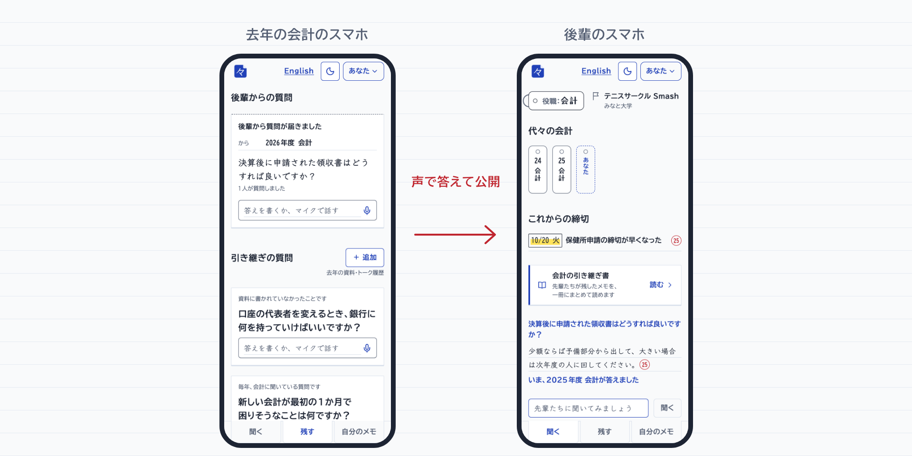
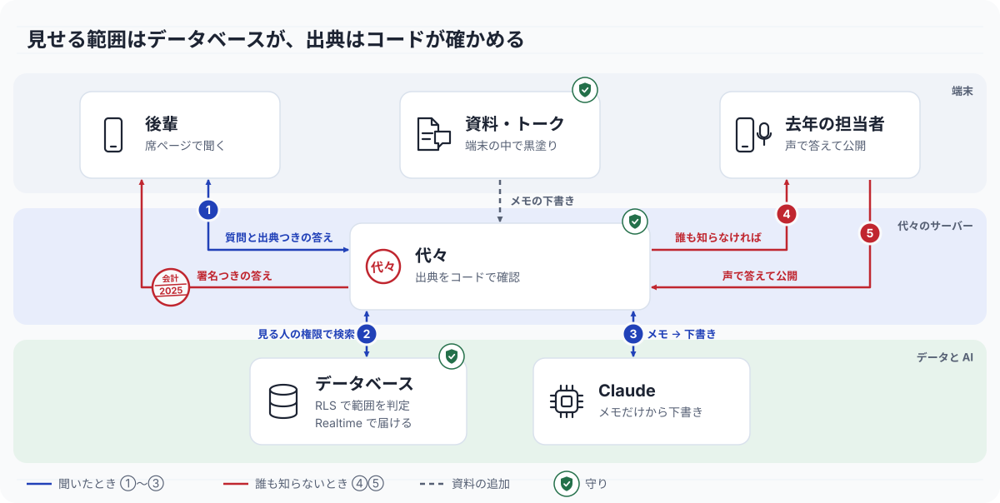

<picture>
  <source media="(prefers-color-scheme: dark)" srcset="docs/images/mark-dark.svg">
  
</picture>

# 代々（Daidai）｜誰も書かない引き継ぎ

[](https://github.com/jphacks/tka_2620/actions/workflows/ci.yml) [](LICENSE)

**後輩の質問に、歴代の先輩のメモだけで答えます。誰も知らないことは去年の先輩のスマホに届き、声で答えるだけで「2025年度 会計」の署名つきメモになります。**

*Daidai (代々, "generation after generation"): the handover nobody writes. Every sentence of an answer cites a predecessor's note. A question nobody can answer goes to last year's holder, who answers by voice.*

<!-- デモ動画（タスク2）ができたら、この <picture> 全体を <a href="https://www.youtube.com/watch?v=VIDEO_ID"> で囲み、リンクの行の先頭に「[デモ動画（90秒）](https://www.youtube.com/watch?v=VIDEO_ID) ・ 」を足す。 -->
<picture>
  <source media="(prefers-color-scheme: dark)" srcset="docs/images/hero-ja-dark.png">
  
</picture>

[しくみ](#しくみ) ・ [試し方](#試し方) ・ [ユーザーの声（13件）](docs/EVIDENCE.md) ・ [Hack Day の全差分](https://github.com/jphacks/tka_2620/compare/pre-hackday...2206aa2) ・ [English](README.en.md)

## 製品概要
### 背景(製品開発のきっかけ、課題等）

サークルの会計、学祭の企画責任者、研究室の機器担当。役職は毎年替わるのに、知っていることは人と一緒にいなくなります。何を書き残せばいいかは、後輩が困るまで誰にも分かりません。2026年10月17日に話を聞いた3人も、同じことで困っていました（名前を出さずに引用することの了承済み。13件の言葉は [docs/EVIDENCE.md](docs/EVIDENCE.md) にあります）。

> 一昨年の引き継ぎがうまくいかず、部室の登録が漏れてしまいました。そのため、今年は部室がありません。（大学ディベートサークルの国際担当。英語の回答を訳出）

> なんなら、タイミングを失って私の代ではできなかった仕事もある……。（駒場祭 飲食企画の責任者）

> 今までの仕事を思い返して自分が引き継ぐべき内容を考えようとしても、その内容を覚えてないなどの理由で、いざ引き継ぎのタイミングになっても十分な引き継ぎがかけない。（高校 運動会の放送担当・卒業誌制作の責任者、経験者）

引き継ぎに要る情報は、Google ドライブや LINE・Slack のやりとりに散らばっています。その置き場所も、任期とは関係なく消えていきます。Slack の無料プランは1年を過ぎたメッセージを削除し<sup>[1](https://www.heise.de/en/news/Slack-deletes-data-from-free-workspaces-after-one-year-9783229.html)</sup>、大学のアカウントは卒業で消えることがあります<sup>[2](https://www.wako.ac.jp/img/library/icc/manual/gmail_drive_migration_20260401.pdf)</sup>。

大学生は2025年度に過去最多の264.6万人で<sup>[3](https://eic.obunsha.co.jp/file/educational_info/2025/1002_1.pdf)</sup>、4年生の51.5%がサークルや部活に入っています<sup>[4](https://career-research.mynavi.jp/wp-content/uploads/2025/01/2026_Lifestyle-1.pdf)</sup>。東京大学の登録団体は、毎年5月末までに継続の届出が必要です<sup>[5](https://www.u-tokyo.ac.jp/ja/students/clubs/h09_01.html)</sup>。

### 製品説明（具体的な製品の説明）

代々では、役職を「席」と呼びます。席は人が替わっても残り、どの席にも同じ3つの操作があります：**聞く**・**残す**・**自分のメモ**。

1. 新しい会計が、部室の鍵の NFC シールにスマホをかざして「模擬店の保健所申請、いつまで？」と聞きます。
2. 答えのすべての文に、根拠になった先輩のメモの年度の印がつきます。年度でルールが変わった文には「2025年に変更」と出ます。
3. どのメモにも答えがない質問には「歴代の会計は誰も知りません。」と答え、去年の会計のスマホに「後輩から質問が届きました」と届きます。
4. 去年の会計は声で答え、下書きを確かめて「公開する」を押します。
5. 後輩の画面に「いま、2025年度 会計が答えました」と、署名つきの答えが出ます。

<!-- ライブループの GIF（タスク9）：docs/images/loop.gif ができたら、このコメント全体を次の1行に置き換える。

-->

「＋ 追加」に前年の資料やトーク履歴を入れると、日付つきのメモの下書きになります。名前や連絡先は送る前に端末の中で黒塗りし、元のファイルは保存しません。書かれていないこと（例：「保健所申請の締切が書かれていません」）は一覧になり、そのまま先輩への質問にできます。

「引き継ぎ書」のページでは、読めるメモ・これからの締切・まだ書かれていないことを1枚にまとめて書き出せます。サークルの役職、留学ルート、研究室の機器担当など、席の種類が違っても画面は同じです。変わるのは、席の種類ごとの言葉だけです。

<!-- 3つの席を並べた静止画（タスク9）：docs/images/seats.png ができたら、このコメント全体を次の1行に置き換える。

-->

### 特長
#### 1. すべての文に出典。確かめられない文は出さない
各文が、実際に検索で見つかったメモを引用しているかをコードで確かめ、確かめられない文は消します。1文も残らなければ「誰も知りません」と答え、質問を先輩に回します。

#### 2. 誰も知らないことは、去年の先輩へ
質問は、同じ席で連絡を受けると決めた先輩にだけ届き、表示は席と年度だけです。先輩が声で答えると、その答えは席に残り、待っていた後輩全員に署名つきで届きます。

#### 3. 見せる範囲はデータベースが決める
メモごとに「次の担当だけ・団体・大学・一般」から見せる範囲を選べ、誰に何が見えるかはアプリではなくデータベースが決めます。撤回したメモは、中央値0.27秒ですべての答えから消えます<sup>[6](metrics/latest.json)</sup>。

### 解決出来ること

| 話を聞いた人の言葉 | 代々では |
|---|---|
| 何を書けばいいか思い出せず、「十分な引き継ぎがかけない」（高校 行事の責任者・経験者） | 書く前に悩む必要はありません。後輩が実際に聞いたことが、そのまま先輩への質問になります。 |
| 「具体的な仕事のタイミングやそもそもその役職の立ち位置や管轄範囲が分からなかったりする……」（駒場祭 飲食企画の責任者） | 先輩のメモにある締切が、席のページに「これからの締切」として並びます。 |
| 「事務手続きや書類の扱い方をもっと知りたかったです」（大学ディベートサークルの国際担当、訳出） | 席に聞けば、歴代のメモから出典つきの答えが返ります。メモになければ先輩に届きます。 |
| 去年の引き継ぎ資料は「特になく、口頭。」（駒場祭 飲食企画の責任者） | 口頭のままで構いません。先輩が声で答えると、日付つきのメモになります。 |
| 情報のありかは「Googleドライブと、LINEやSlackでの相談に対する返答。」（同） | 「＋ 追加」で資料やトーク履歴を入れると、黒塗りしてからメモの下書きにします。 |

### 他との違い

一般的な AI は「自分たちの先代」を知りません。

| | 書かれたものを探す AI（Notion AI<sup>[7](https://www.notion.com/help/enterprise-search)</sup>・NotebookLM<sup>[8](https://support.google.com/notebooklm/answer/16269187?hl=en)</sup> など） | 社内 Q&A（Qast<sup>[9](https://thebridge.jp/2024/12/any-operator-of-a-knowledge-platform-raises-1-055-billion-yen-in-series-b-funding)</sup>・Tettra<sup>[10](https://support.tettra.com/article/110-asking-questions-in-tettra)</sup>・Guru<sup>[11](https://help.getguru.com/docs/using-guru-answers-to-find-trusted-information)</sup> など） | 代々 |
|---|---|---|---|
| 答えの根拠 | 出典を示す | 投稿をもとに回答 | すべての文に出典。確かめられない文は出さない |
| 答えがないとき | 書かれていなければ答えられない | 今いる社員の専門家に聞く | 去年の先輩に届き、声で答えてもらう |
| 共有の単位 | ノートブック・ワークスペース | 社内 | メモごと（次の担当だけ／団体／大学／一般）、撤回は1秒以内 |
| 対象 | 個人・企業 | 企業 | 毎年役職が替わる学生団体 |

<sub>2026年10月時点の各社の公開ドキュメントによる。</sub>

### 今後の展望

Award Day に進めたら、11月の代替わりで2〜3団体に無料で使ってもらいます。①先輩が答えた割合、②答えるまでの時間、③「誰も知りません」が減った数を測り、あわせて公開デモを用意します。研究室の機器担当や留学ルートの席は、同じ画面ですでに動きます（デモ用データあり）。

### 注力したこと（こだわり等）
- **画面に AI を出さない**：答えは「先輩」から。画面には「AI」の文字もキラキラも出しません。
- **AI ツールにも同じルール**：範囲はデータベースで守る、すべての文に出典、ファイルは端末の外に出さない、という3つのルールを [AGENTS.md](AGENTS.md) で全ツールに渡し、機能ごとに PR を分けました。
- **数字で確かめる**：漏れ・撤回・出典・黒塗り・ライブループを `pnpm metrics` で測っています<sup>[6](metrics/latest.json)</sup>。

## 開発技術
### しくみ

<picture>
  <source media="(prefers-color-scheme: dark)" srcset="docs/images/architecture-ja-dark.svg">
  
</picture>

1. **質問と出典つきの答え**：代々は、後輩の質問を本人の権限のままデータベースに渡します。
2. **見る人の権限で検索**：何が見つかるかは、データベースの RLS のポリシーだけが決めます。
3. **出典の確認**：Claude は読めるメモだけから下書きを書き、代々のコードが文ごとに出典を確かめます。
4. **誰も知らないとき**：質問は Realtime で去年の先輩のスマホに届きます。
5. **声で答えて公開**：先輩の答えは席に残り、待っていた質問に署名つきで返ります。

緑の盾は守りの3か所（端末の中での黒塗り、データベースによる範囲の判定、コードによる出典の確認）です。

### 活用した技術
#### API・データ
* Claude API（Anthropic）：回答・メモの下書き・資料からの抽出（Sonnet）、追加質問と質問の整理（Haiku）
* Ollama + bge-m3：メモと質問のベクトル化（1,024次元）
* Supabase：Postgres + pgvector、行単位セキュリティ（RLS）、Realtime、認証
* Web Speech API（`ja-JP`）：声で答える入力
* デモ用データ：架空のサークル・学祭・研究室・留学ルートのメモ、質問、トーク履歴（`seed/`）

#### フレームワーク・ライブラリ・モジュール
* Next.js 16、React 19、TypeScript、Tailwind CSS 4、next-intl（日本語・英語）
* Vercel AI SDK、Zod（API とモデル出力の検証）
* pdfjs-dist・mammoth（PDF・Word の文字をブラウザの中で抜き出す）
* Vitest、Biome、GitHub Actions

#### デバイス
* スマートフォン：質問する後輩と、声で答える先輩
* NFC タグ：部室の鍵に貼り、かざすと席のページが開きます（印刷した QR コードでも同じ）
* ノートPC：3人の画面を並べたデモ用のコンソール（`/console`）

### 独自技術
#### ハッカソンで開発した独自機能・技術
すべて Hack Day 中に作りました（「[Hack Day 中に作ったもの](#hack-day-中に作ったもの)」）。

- [`lib/engine/answer.ts`](lib/engine/answer.ts)：モデルに渡したメモを引用している文だけを残し、1文も残らなければ答えずに先輩へ回します。
- [`lib/engine/rule-change.ts`](lib/engine/rule-change.ts)：ルール変更の印を `deadline_date` から計算します（モデルは使いません）。
- [`supabase/migrations/0004_search_notes.sql`](supabase/migrations/0004_search_notes.sql)：見る人の権限で動く検索関数。何が見つかるかは [`0002_notes_rls.sql`](supabase/migrations/0002_notes_rls.sql) のポリシーだけが決めます。
- ライブループ：質問の保存と配信を1つのトランザクションで行い、公開すると待っていた質問すべてに答え直します（[#67](https://github.com/jphacks/tka_2620/pull/67)・[#80](https://github.com/jphacks/tka_2620/pull/80)・[#114](https://github.com/jphacks/tka_2620/pull/114)）。
- [`lib/redact/redact.ts`](lib/redact/redact.ts)：端末の中で黒塗りし、`/api/import` が同じ規則でもう一度確かめて、残っていれば受け付けません（[#99](https://github.com/jphacks/tka_2620/pull/99)）。
- [`scripts/check-leak.ts`](scripts/check-leak.ts)：すべての利用者 × すべての公開範囲で、漏れがないかを試します。

## Hack Day 中に作ったもの

10/17 10:20〜10/18 15:00 に、`dev` へ 74 本の PR をマージしました（マイグレーション 11 本、テストファイル 39 個を追加）。表は主な PR で、すべての変更は全差分 [pre-hackday...2206aa2](https://github.com/jphacks/tka_2620/compare/pre-hackday...2206aa2) にあります。

| 機能 | 内容 | 主な PR |
|---|---|---|
| F1 公開範囲のしくみ | 見せる範囲をデータベースが判定し、見る人が読めるメモだけを返す | [#58](https://github.com/jphacks/tka_2620/pull/58)・[#63](https://github.com/jphacks/tka_2620/pull/63)・[#65](https://github.com/jphacks/tka_2620/pull/65) |
| F2 出典つきの回答 | すべての文に出典をつけ、根拠がなければ「誰も知りません」。年度で変わったルールに印をつける | [#72](https://github.com/jphacks/tka_2620/pull/72)・[#74](https://github.com/jphacks/tka_2620/pull/74)・[#79](https://github.com/jphacks/tka_2620/pull/79) |
| F3 ライブループ | 答えのない質問が先輩のスマホに届き、声の答えが署名つきで後輩に届く | [#67](https://github.com/jphacks/tka_2620/pull/67)・[#80](https://github.com/jphacks/tka_2620/pull/80)・[#114](https://github.com/jphacks/tka_2620/pull/114) |
| F4 信頼の証明 | 部外者に何も見えないこと、撤回が1秒以内に答えから消えることをコンソールで示す | [#77](https://github.com/jphacks/tka_2620/pull/77)・[#84](https://github.com/jphacks/tka_2620/pull/84)・[#93](https://github.com/jphacks/tka_2620/pull/93) |
| F5 すでにあるものを追加 | 資料やトーク履歴を端末の中で黒塗りしてからメモにし、書かれていないことを一覧にする | [#95](https://github.com/jphacks/tka_2620/pull/95)・[#99](https://github.com/jphacks/tka_2620/pull/99)・[#103](https://github.com/jphacks/tka_2620/pull/103) |
| F6 引き継ぎの質問 | 後輩が聞いたことを先輩への質問にし、声で答えるとメモの下書きになる | [#100](https://github.com/jphacks/tka_2620/pull/100)・[#110](https://github.com/jphacks/tka_2620/pull/110)・[#111](https://github.com/jphacks/tka_2620/pull/111) |
| F7 席ページと NFC の入り口 | 鍵の NFC シールで席ページが開き、歴代の系譜・締切・質問欄が出る | [#112](https://github.com/jphacks/tka_2620/pull/112)・[#113](https://github.com/jphacks/tka_2620/pull/113)・[#120](https://github.com/jphacks/tka_2620/pull/120) |
| 引き継ぎ書 | 読めるメモ・締切・まだ書かれていないことを1枚にまとめて書き出す | [#118](https://github.com/jphacks/tka_2620/pull/118) |

## Hack Day 前に用意したもの

| 内容 | コミット（日時） |
|---|---|
| スターターキット（ルールの文書、AI ツールの設定、デザイントークン、日英の文言、サンプル資料） | [ba9b9a0](https://github.com/jphacks/tka_2620/commit/ba9b9a0)（10/16 19:35） |
| Next.js の骨組み（空の画面） | [214d33e](https://github.com/jphacks/tka_2620/commit/214d33e)（10/16 20:12） |
| Supabase のテーブル（ポリシーなし）と、Claude・Ollama の接続確認 | [862b135](https://github.com/jphacks/tka_2620/commit/862b135)（10/16 22:15） |
| 画面確認の設定とサーバー設定の共有 | [5e7d783](https://github.com/jphacks/tka_2620/commit/5e7d783)（10/16 23:18） |
| デモ用データのスクリプト、bge-m3 のベクトル化、スマホ用のトンネル | [277268e](https://github.com/jphacks/tka_2620/commit/277268e)（10/17 00:06） |
| README の骨子 | [109c388](https://github.com/jphacks/tka_2620/commit/109c388)（10/17 00:37）・[a39a38e](https://github.com/jphacks/tka_2620/commit/a39a38e)（00:48） |

Hack Day 前の最後の状態は、タグ [`pre-hackday`](https://github.com/jphacks/tka_2620/tree/pre-hackday)（10/17 00:59、[#48](https://github.com/jphacks/tka_2620/pull/48)）です。その時点で、`app/` は空のページと共通レイアウトだけ、`components/` は 0 ファイル、データベースのポリシーは 0 本でした。Hack Day の作業は 10/17 10:20 に始めました。

## コードフリーズ後の変更

コードフリーズ（10/18 15:00。`main` は [2206aa2](https://github.com/jphacks/tka_2620/commit/2206aa2) で、中身は 14:58 の `dev` と同じ）のあとに変えたのは、README と画像だけです。コードは変えていません。差分：[2206aa2...main](https://github.com/jphacks/tka_2620/compare/2206aa2...main)

## 試し方

データベースと AI なしのモックで、画面を手元で動かせます（Node 22.18 以上、pnpm 10）。

```bash
pnpm install
NEXT_PUBLIC_USE_MOCKS=1 pnpm dev
```

http://localhost:3000/s/smash-kaikei を開き、次の順に試してください（3分ほど）。

1. 「模擬店の保健所申請、いつまで？」と聞く → すべての文に年度の印がつき、「2025年に変更」が出ます。
2. 「決算後に申請された領収書はどうすれば良いですか？」と聞く → 「歴代の会計は誰も知りません。」のあと、モック用のボタン「先輩が答えて公開する（モック）」を押すと、「いま、2025年度 会計が答えました」と署名つきの答えが出ます。
3. http://localhost:3000/console の「去年の会計」で、「保健所申請の締切が早くなった」の「撤回する」を押す → メーターが秒数を示し、「新しい会計」の答えから「2025年に変更」の文が消えます。「部外者」には何も出ません。
4. 席ページの「残す」→「＋ 追加」→「トーク履歴」で、架空のトーク [`seed/chat-line.sample.txt`](seed/chat-line.sample.txt) を入れ、「この役割で隠す」→ 同意のチェック →「この内容だけを送る」→ 隠した件数と「〇〇が書かれていません」の一覧が出ます。

本物のデータで動かすには、Supabase のプロジェクト、Anthropic の API キー、`bge-m3` を入れた Ollama が要ります。`.env.example` を `.env.local` にコピーして値を入れ、`supabase db push`、`pnpm seed`、`pnpm dev` の順に実行します。デモ用アカウントのパスワードは `DEMO_PASSWORD` です。

## チーム・ライセンス

チーム tka_2620：エンジン（検索・権限・API・計測）[@Nico4899](https://github.com/Nico4899)、画面 [@PenguinCabinet](https://github.com/PenguinCabinet)、内容・ユーザー調査・発表 [@yonage](https://github.com/yonage)

ライセンス：[MIT](LICENSE)
